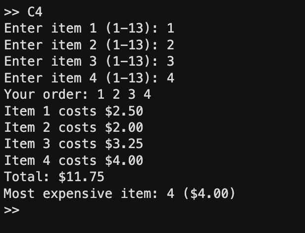
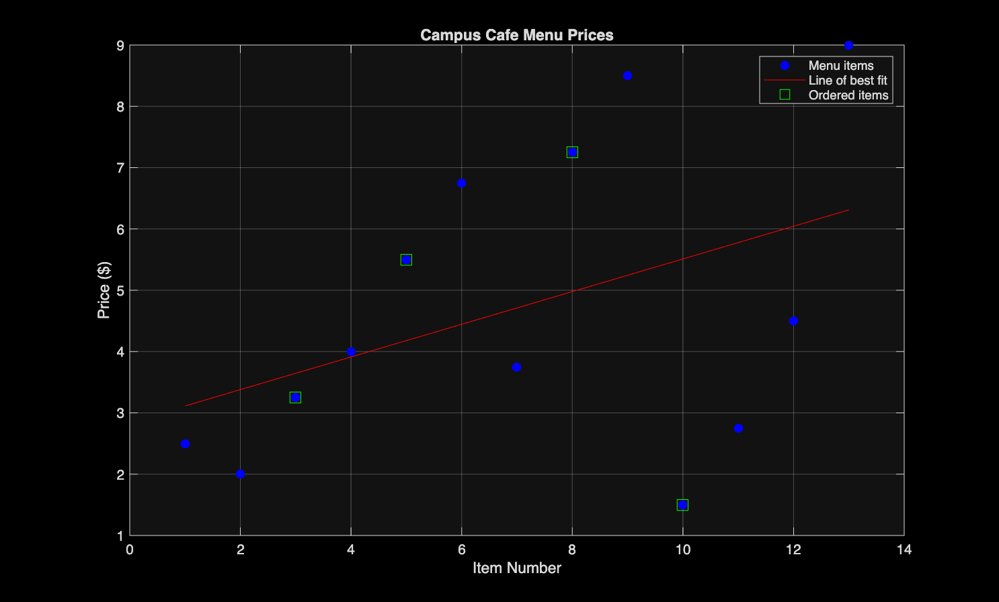

# ENGE 1215 Challenge 4

matlab script for challenge 4. reads excel file, gets 4 items from user, finds total and most expensive item, saves receipt to TeamResults.csv and plots it.

output of the terminal:

output of selecting 1 2 3 4:

kthxbye - whron@vt.edu
